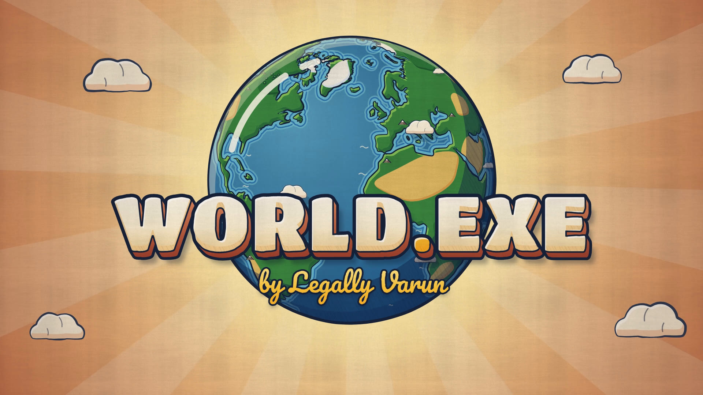

# WORLD.EXE: animated intro

An 8-second, hand-drawn-style 2D animated opening for **WORLD.EXE** by Legally Varun.
The animation is drawn frame by frame with JavaScript on a `<canvas>`. The music and sound effects are
synthesised from scratch in Python. Both read the same cue sheet, so every drawn action lands on its sound.



**Watch:** [`out/world_exe_intro.mp4`](out/world_exe_intro.mp4) (1920×1080, 60 fps, H.264 + AAC 320k, exactly 8.000 s)
**Score:** [`audio/world_exe_score.wav`](audio/world_exe_score.wav) (48 kHz / 24-bit stereo, mastered to about −15 LUFS, −1 dBFS ceiling)

---

## The film, beat by beat

| Time | What you see | What you hear |
|---|---|---|
| 0.0 – 1.0 | An illustrated ocean under a hand-drawn sun. A little wave gathers, sinks back, then rears up, stretches and curls. Its foam lip spirals over with "claws" of spray. | Harp and celesta draw the world in over a soft D pedal. The **theme** (A–D–E–F♯) arrives on flute. A watery swoosh follows the wave from left to centre. |
| 1.0 – 1.5 | The wave crashes into a river mouth. From the splash, the sea **blooms into land**: hills spring up with an elastic overshoot, and the river is carved up the valley by a racing foam surge. | A soft splash, a felt thud and water droplets, then a leafy rustle as the land spreads. |
| 1.0 – 1.6 | Mountains are **inked in** with a pencil line, then pop up with squash and stretch. Their snowcaps pop a beat later. | A pencil scratch, then a tuned wooden *pop* for each mountain (D, F♯, A). |
| 1.2 – 2.0 | Trees sprout and sway with overlapping action. Little clouds **hop** across the sky, squashing on each landing. The multiplane camera glides up the river. | A sparkle of harp plucks, one per tree. A soft pizzicato *bum* on each cloud hop. |
| 2.0 – 2.5 | The centre mountain squashes (anticipation), then **stretches** skyward. The camera swoops up and into it, and a watercolour bloom opens *inside the mountain* onto a new landscape seen from above. | A rising whoosh and a harp glissando that climbs with the camera. |
| 2.5 – 3.0 | A patchwork of fields. A road **paints itself** across the land with a round brush head. Five little houses pop up beside it, with chimney puffs. | A pizzicato walking groove and shaker. The houses pop on a rising pentatonic run. |
| 3.0 – 3.4 | The road wriggles and **turns into a coastline**. Sand replaces the road and the sea floods in from the far side. A sailing boat glides off, its wake **curling up** into a flourish. | A watery flood that sweeps right to left, surf, and a little ship's bell. |
| 3.4 – 4.0 | The camera pulls back about 20× while the coastline **bends into the outline of Africa**. Europe, Asia and the Americas draw themselves in around it. | Air rushing away, faint pencil scribbles, and a harp running upward. |
| 4.0 – 5.0 | The flat illustrated map **curls around an invisible sphere**. Its ocean edges roll away like a wave, and the sheet closes into a planet. | A papery roll that narrows from wide stereo to the centre. Strings and horns swell into a timpani roll, then a warm arrival on A. |
| 5.0 – 6.0 | Ripples cross the oceans. The globe winds up, spins a full turn with smear lines and a squash, overshoots, and settles on the Atlantic. | Water ripples, a breath in, then a whoosh that travels around the stereo field. A string run climbs the A Mixolydian scale. |
| 6.0 – 6.8 | **WORLD.EXE** drops in letter by letter. Each letter stretches as it falls, squashes on landing, rebounds and settles. The dot is a little sunny-yellow ball. | A D-major arrival: the theme in horns and violins. Each letter lands on a rising celesta and pizzicato note, with a soft felt thump. |
| 6.7 – 7.3 | ***by Legally Varun*** is written on in warm yellow script, followed by a pen glint. The globe completes a final small turn. | A gentle harp arpeggio and a faint pen scratch. |
| 7.28 | A twinkle pops off the dot. | **The signature chime:** glockenspiel, celesta, bell and harp over a D add9 bloom, with the theme resolving up to A. |
| 7.5 – 8.0 | The completed logo holds still. | The music rings out and fades to silence at 8.0 s. |

## How it's made

### Animation (JavaScript, `src/`)
Everything is drawn procedurally with Canvas 2D. There are no images. `WX.renderAt(t)` is deterministic, so the live
player and the frame-accurate offline render share the same code.

- **Hand-drawn feel** (`src/core.js`)
  - *Line boil:* every outline is re-traced 12 times a second, like pencil animation shot on twos.
  - *Brush-pressure ink:* outlines are filled ribbons that swell and taper.
  - *Watercolour fills:* pigment texture is multiplied into the fills.
  - *Cel-shading:* each shape is offset from itself to cut hard-edged shadows and highlights, with pencil hatching in the shadows.
  - *Paper grain:* a grain layer sits over the whole frame.
- **Scene A** (`src/sceneA.js`)
  - A multiplane, pseudo-3D valley: rows of rolling hills, a meandering river carved through notches in the ridges, and haze with distance.
  - The sea-to-land bloom, where hills rise on springs as the bloom front reaches them.
  - The hero wave, built from a back slope, a spiral lip, its eye and a foam ribbon, with squash and stretch.
- **Scene B** (`src/sceneB.js`)
  - The top-down patchwork landscape, painted road and popping houses.
  - The road morphs into the coast with a travelling wriggle.
  - The coastline polygon is resampled against Africa's real outline, split at the Horn and Mozambique so each part maps to its counterpart. It morphs point by point while a single camera zooms out about 22×.
- **Scene C** (`src/sceneC.js`): one projection family covers both the flat map and the globe.
  - Curvature `k` goes from 0 to 1 and puts the map onto a sphere of radius `R/k`. At `k=0` that is an equirectangular map, at `k=1` an orthographic globe.
  - Every coastline really does bend as the map rolls up.
  - The globe has vintage-map coastal rings, deserts, forests and ice, little mountain and tree icons, drifting clouds with cast shadows, sphere cel-shading with hatching, a cartoon shine, and spin smears.
- **Title** (`src/title.js`): the letters are the real glyph outlines of the fonts, extracted with opentype.js. Each one is drawn as an inked, extruded, cel-shaded shape that can squash and stretch. The subtitle is written on with a moving reveal.

### Music & sound (Python, `audio/score.py`)
Pure numpy/scipy synthesis:
- Bowed string sections: detuned band-limited saws with vibrato and bow noise, spread in stereo.
- Horns, with a filter that opens as they swell.
- Flute.
- Additive harp and pizzicato.
- Celesta, glockenspiel, bell and marimba from their partial series.
- Timpani with a glide and rolls, triangle, a soft-mallet cymbal, and shaker.

Effects are noise sculpted by moving filters in the STFT domain, plus granular rustles, pencil scratches and tuned
pops. A synthetic stereo convolution reverb glues it together. The master is levelled with BS.1770 K-weighted
loudness and a soft-knee limiter.

The tempo is 120 bpm, so **each 2-second scene is exactly one bar**. The theme is heard three times:
flute in bar 1, violins a step higher in bar 3, and full horns and strings under the title in bar 4.

### The shared cue sheet
[`timeline.json`](timeline.json) holds every cue: wave crash, mountain pops, house pops, letter landings, the chime
and so on. `tools/build_data.js` copies it to `data/timeline.js` for the browser, and `audio/score.py` reads it directly.

## Run it

Requirements: Node 18+, Python 3 with `numpy` and `scipy` (`pip install -r audio/requirements.txt`), and `ffmpeg`.
Playwright's Chromium is needed for rendering.

```bash
npm install                 # opentype.js (glyph extraction) + playwright (offline render)
npm run build:data          # coastlines, glyph outlines, cue sheet  -> data/*.js
npm run build:audio         # python3 audio/score.py                 -> audio/world_exe_score.wav
npm run render              # 480 frames @ 60 fps + ffmpeg mux       -> out/world_exe_intro.mp4
# or all three:  npm run build
```

- **Live:** open `index.html` in a browser and press ▶. The player renders in real time, clocked to the audio. Drag the slider to scrub, or add `?full` to force full 1080p drawing.
- **Spot-check frames:** `node tools/frames.js 1.2 3.7 7.5`, or `node tools/frames.js --sheet 0 8 0.5` for a contact sheet.
- **Check sync:** `python3 audio/score.py --spectrogram` writes a spectrogram with the cue times marked.

## Files

```
index.html            live player (canvas + audio, scrubber)
timeline.json         shared cue sheet (animation + score)
src/core.js           drawing kit: noise, boil, ink, watercolour, cel-shading, clouds, trees
src/sceneA.js         ocean -> wave -> valley -> mountain swoop
src/sceneB.js         patchwork land -> road -> coast -> boat -> pull back to Africa
src/sceneC.js         world map renderer, map->globe curl, spin, final globe & backdrop
src/title.js          WORLD.EXE letters + "by Legally Varun"
src/intro.js          frame orchestration + paper/vignette grade
audio/score.py        original score + synchronised sound design
tools/build_data.js   builds data/ from Natural Earth + the fonts
tools/render.js       headless frame render + ffmpeg encode
tools/frames.js       preview stills / contact sheets
data/                 generated browser data (geo, glyphs, timeline)
fonts/                Titan One & Pacifico (SIL Open Font License)
assets/               Natural Earth 1:110m land (public domain)
```

## Credits
- Typefaces: [Titan One](https://fonts.google.com/specimen/Titan+One) by Rodrigo Fuenzalida and [Pacifico](https://fonts.google.com/specimen/Pacifico) by Vernon Adams, Jacques Le Bailly, Botjo Nikoltchev and Ani Petrova, both under the SIL Open Font License 1.1 (see `fonts/`).
- Coastlines: [Natural Earth](https://www.naturalearthdata.com/) 1:110m land, public domain.
- Everything else (drawings, animation, music, sound) is original and generated by the code in this folder.
